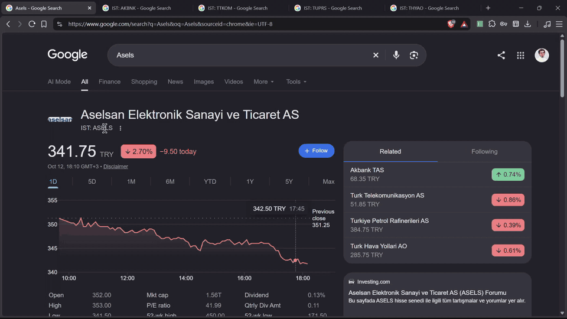

# Katılım Endeksi Checker — 1.4.3

Check BIST participation-index membership and available official company/fund disclosures from the browser. **Free public sources · No API key · No account · No local server.**

[Download Chrome ZIP](https://github.com/EnesAhmet10000/katilim-endeks-checker/releases/download/v1.4.3/katilim-finans-chrome-v1.4.3.zip) · [Release and audit attachments](https://github.com/EnesAhmet10000/katilim-endeks-checker/releases/tag/v1.4.3) · [العربية: طريقة التثبيت](docs/INSTALL-AR.md)

## Demo video

[](https://github.com/EnesAhmet10000/katilim-endeks-checker/releases/download/v1.4.3/katilim-demo.mp4)

[Download the full video — MP4, 56 seconds, original recording with audio](https://github.com/EnesAhmet10000/katilim-endeks-checker/releases/download/v1.4.3/katilim-demo.mp4)

The recording shows the extension on real stock-search pages, including full details, custom visibility options and source navigation. The animated preview is silent; the full MP4 preserves the original recording and audio. Displayed dates and results belong to the recording.

## How to use

1. Download the ZIP from [Releases](https://github.com/EnesAhmet10000/katilim-endeks-checker/releases/latest) and extract it to a folder.
2. Open `chrome://extensions`, enable **Developer mode**, choose **Load unpacked**, and select the extracted folder containing `manifest.json`.
3. Select a ticker, company name or fund code on a normal webpage, right-click, and choose **Katılım Uygunluğunu Kontrol Et**. You can also search from the extension popup.
4. Choose **Basit**, **Tam** or **Özel**. Click **Yenile** to request fresh source data.

For an existing installation, extract the new ZIP into its installation folder, click **Reload** in `chrome://extensions`, and reload the target webpage.

## Result colors

- **Green:** verified participation-index membership or explicit supported compliance evidence. Index membership by itself is not a complete halal assessment.
- **Red:** explicit non-compliance when supported by the evaluation. Red index chips mean absence from that specific index; they do not automatically mean the company is haram.
- **Yellow:** unknown, unavailable, stale or future-dated evidence. A registered participation fund is not automatically approved based on its name or umbrella alone.

The current public-source pipeline reports index membership and company declarations separately; it does not calculate a complete automatic halal/haram verdict.

## Live audit — 13 October 2026

The packaged worker was tested on **30 randomly selected equity companies**, then its output was independently compared with captured official KAP HTML and BIST CSV data using Python.

| Check | Result |
|---|---|
| Equity eligibility, identity and KAP links | 30/30 verified |
| Seven index memberships per company | 210/210 matched the dated BIST CSV |
| Available KAFİF disclosures | 182 fields matched across 26 companies |
| Companies without a matching KAFİF row | 4; financial data remained unavailable |
| Extraction errors after the annual-period fix | 0 in the final sample |

Three KAP company pages omit the equal-weight index shown in the dated BIST CSV; the audit records that difference. These checks validate data extraction from available sources, not the correctness of every source statement, a complete religious assessment, or installed-Chrome context-menu behavior.

Version **1.4.3** fixes valid annual KAFİF periods written as `2025 / Yıllık`, while retaining future-period rejection.

[Audit report (Arabic)](docs/AUDIT-30-2026-10-13.md) · [CSV](docs/AUDIT-30-2026-10-13.csv) · [JSON evidence and response hashes](docs/AUDIT-30-2026-10-13.json)

## Features and data sources

Display modes are available in both the result card and popup: **Basit** (result and source actions), **Tam** (all details, default), and **Özel** (choose visible sections using **Özelleştir**). Preferences stay in local extension storage, apply to stocks and funds, survive refresh/reopening, and synchronize across open extension views. Presentation choices do not change the evaluation or source requests.

Select a BIST ticker, company name, fund code or full fund name, right-click and choose **Katılım Uygunluğunu Kontrol Et**. The Chrome extension resolves the official KAP identity, reads BIST participation membership, KAFİF disclosures and available TEFAS fund profiles/asset allocation. It works without an API key, account, subscription or local server.

## What changed

- PETKİM / Petkim / PETKM / BIST:PETKM resolve to **PETKM** and its numbered KAP summary URL.
- Company identities are refreshed from the KAP BIST directory at most once per 24 hours on use. A 12 October 2026 identity-only snapshot is bundled for offline resolution.
- Coverage is directory-wide: 803 company symbol entries and 3,523 fund codes from KAP's ALL fund directory, including participation and conventional funds, pension funds and exchange-traded funds. The company directory includes additional issuer codes and bond issuers; every directory entry is not necessarily a listed equity. These counts describe identities, not completed financial assessments or TEFAS availability.
- Fund identities are refreshed daily on use. The current official KAP fund page is read for umbrella name/type when those fields exist. Missing umbrella fields remain unknown; portfolio and religious approval are not inferred from the fund name.
- Search covers both directories. For code collisions, the user selects the intended instrument. `BIST:CODE` and `FON:CODE` explicitly choose stocks or funds.
- Source results are fetched on demand and cached for one hour. **Yenile** bypasses identity, result and shared-source caches. Failed refreshes do not reuse expired results or produce a negative or positive compliance verdict.
- Static sample ratios, synthetic disclosure links and inferred Helal Finans/Fintables observations are excluded from the production result. Their buttons are links for manual review.
- Seven BIST participation indices are read from the official dated CSV. Lists dated tomorrow are labelled as upcoming rather than today's membership; older than seven days or further-future files fail closed.
- KAFİF activity/governance declarations and three financial ratios are read with the financial period and identity verification. Missing values stay unknown; disclosed ratios do not automatically become a religious verdict.
- TEFAS profiles and dated asset-type allocation are queried for mutual, pension and ETF funds when supported. Allocation older than 14 days is not used. Null interest-content does not mean interest-free. Individual holdings and approval documents still require separate review.
- Free public-source access was tested; availability and redistribution rights are not guaranteed. There is no paid fallback or bypass of source access restrictions.
- Chrome uses activeTab injection on request; no all-page content script, all_urls permission or localhost connection.

## Build and test

```sh
npm install
npm run build
npm test
```

Load `apps/extension/dist/chrome` through `chrome://extensions` → Developer mode → Load unpacked. Reload an existing unpacked installation and reload the target page after updating.

The deterministic engine and legacy dataset remain for unit examples and are excluded from the production extension. Production extension and optional API checks use `public-sources.ts`. The optional API is not required, deployed or contacted by the extension.

## Delivery and limitations

- [Arabic installation guide](docs/INSTALL-AR.md)
- [Chrome Store preparation](docs/CHROME-STORE-AR.md)
- [Privacy policy draft](docs/privacy-policy.html)
- [QA evidence](docs/QA-2026-10-12.md)
- [1.3 release, security checks and limitations (Arabic)](docs/RELEASE-1.3.0-AR.md)
- [Actual live-source evidence](docs/public-source-coverage-2026-10-12.json)

The v1.4.3 ZIP is downloadable from GitHub Releases for local installation. No Chrome Web Store upload or publication has occurred. Store approval and installed-browser context-menu checks remain separate from the code, fixture, worker, rendered-interface and live-fetch tests. Chrome Store developer registration has a one-time fee; local installation is free.

KAP markup may change or requests may be blocked. Parsing failures fail closed and show unavailable data. Index membership alone is not a complete religious assessment or investment recommendation.
