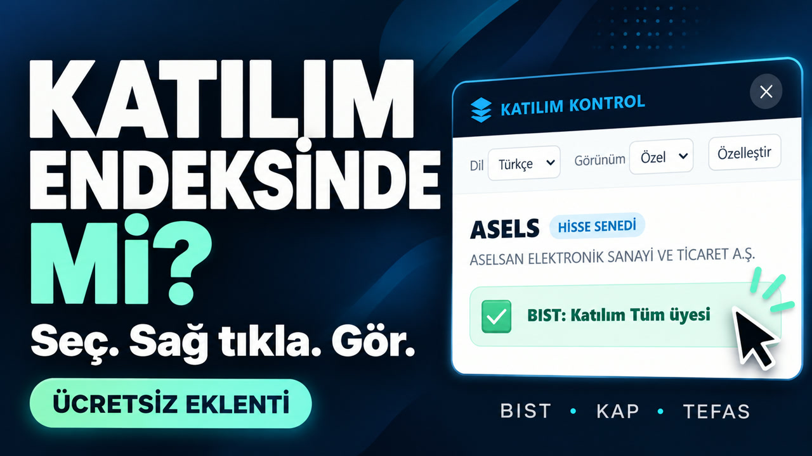
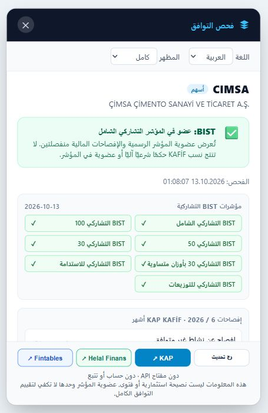
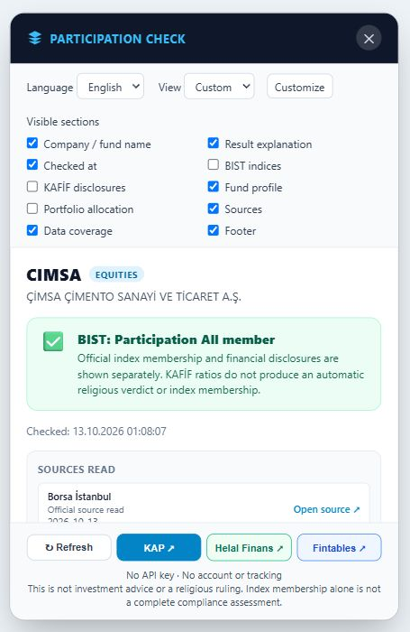

# Katılım Endeksi Checker

### Select a ticker. Right-click. See the official data.

Turkish stocks BIST & funds, checked from the page you're already on.
 
**BIST · KAP · TEFAS**

**Free to use · No account · No API key · No tracking**

**[↓ Download for Chrome](https://github.com/EnesAhmet10000/katilim-endeks-checker/releases/latest)** &nbsp; · &nbsp; **[▶ Watch on YouTube](https://youtu.be/j1KZuk8OvZg)**

[English](#what-you-can-do) &nbsp; / &nbsp; [Türkçe](#türkçe) &nbsp; / &nbsp; [العربية](#العربية)

**[▶ Play the demo · Videoyu izle · شاهد الفيديو](https://youtu.be/j1KZuk8OvZg)**
 
Click the thumbnail to watch on YouTube.

---

## What you can do

| Check | Explore | Make it yours |
| :--- | :--- | :--- |
| See BIST participation-index membership and available KAFİF company disclosures. | Look up stocks and funds by name or code, open source links, and refresh the data. | Switch between Arabic, English and Turkish. Choose a simple, full or custom view. |

## Your language. Your view.

<table>
  <tr>
    <th>العربية · Full view</th>
    <th>English · Custom view</th>
  </tr>
  <tr>
    <td align="center"></td>
    <td align="center"></td>
  </tr>
</table>

Screenshots show recorded results. The video demonstrates the core interaction; it predates the language selector.

## Get started

1. **[Download the Chrome ZIP](https://github.com/EnesAhmet10000/katilim-endeks-checker/releases/latest)** and extract it into a folder.
2. Open `chrome://extensions` and enable **Developer mode**.
3. Click **Load unpacked** and choose the extracted folder containing `manifest.json`.
4. Select a stock or fund name on a webpage, **right-click**, and choose the extension's check command.

You can also search from the extension popup. Use **Refresh** to request fresh data.

Installed locally from GitHub Releases. Not yet published in the Chrome Web Store.

[Detailed installation guide →](docs/INSTALL-AR.md)

## العربية

**حدد السهم. اضغط كلك يمين. شوف بياناته من المصادر الرسمية.**

إضافة مجانية للأسهم والصناديق التركية تجمع عضوية مؤشر المشاركة والإفصاحات المتاحة وروابط المصادر في بطاقة داخل الصفحة. اختر العربية أو الإنجليزية أو التركية، والمظهر البسيط أو الكامل، أو خصص الأقسام التي تريدها. البيانات الناقصة تظهر بوضوح.

**[تحميل الإضافة](https://github.com/EnesAhmet10000/katilim-endeks-checker/releases/latest) · [شاهد طريقة الاستخدام](https://youtu.be/j1KZuk8OvZg) · [دليل التثبيت](docs/INSTALL-AR.md)**

## Türkçe

**Hisseyi seç. Sağ tıkla. Resmi verileri gör.**

BIST hisseleri ve fonlar için ücretsiz Chrome eklentisi. Katılım endeksi üyeliğini, mevcut şirket beyanlarını ve kaynak bağlantılarını bulunduğunuz sayfada görün. Türkçe, Arapça veya İngilizce kullanın; basit, tam ya da kişiselleştirilmiş görünümü seçin.

**[Eklentiyi indir](https://github.com/EnesAhmet10000/katilim-endeks-checker/releases/latest) · [Kullanım videosunu izle](https://youtu.be/j1KZuk8OvZg)**

---

### Sources & transparency

The extension reads BIST index lists, KAP company and fund records, and available TEFAS fund data. Missing data is shown explicitly. Index membership alone is not a complete halal assessment; the extension does not issue investment advice or a fatwa.

[30-stock source audit](docs/AUDIT-30-2026-10-13.md) · [Release notes](docs/RELEASE-1.5.0.md) · [Original demo MP4](https://github.com/EnesAhmet10000/katilim-endeks-checker/releases/download/v1.5.0/katilim-demo.mp4)

Created by **[Enes Ahmet](https://www.linkedin.com/in/enesahmet10000/)**

